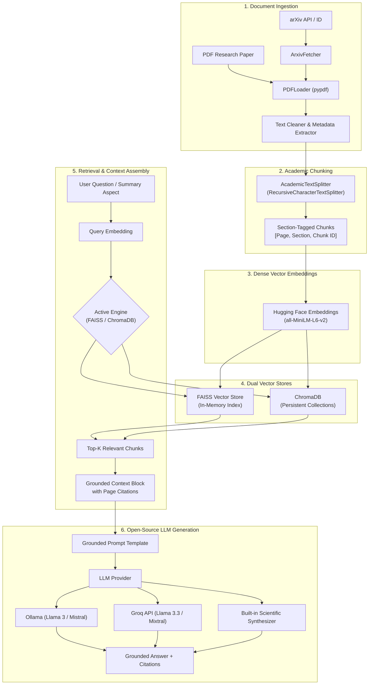

# AI Research Paper Summarizer & Question Answering (RAG)

An enterprise-grade **Retrieval-Augmented Generation (RAG)** assistant built with **Python**, **LangChain**, **FAISS**, **ChromaDB**, **Hugging Face**, and open-source Large Language Models (**Llama 3** & **Mistral**).

---

## Key Features

- **Multi-Source Paper Ingestion**:
  - Pre-bundled landmark AI papers (*Attention Is All You Need*, *LoRA*, *RAG*, *Mistral 7B*).
  - Drag-and-drop custom PDF uploader with automated text cleaning and ligature correction.
  - Direct arXiv search & auto-downloader by arXiv ID (e.g., `1706.03762`) or query.

- **Scientific Section-Aware Chunking**:
  - Extracts and tags academic sections (*Abstract*, *Introduction*, *Methodology*, *Experiments*, *Results*, *Limitations*, *Conclusion*).
  - Preserves exact page numbers and metadata on every chunk for fine-grained source attribution.

- **Hugging Face Dense Vector Embeddings**:
  - Default: `all-MiniLM-L6-v2` (384-dim, fast, normalized cosine similarity).
  - Selectable alternatives: `BAAI/bge-small-en-v1.5` and `all-mpnet-base-v2` (768-dim).

- **Dual Vector Store Architecture (FAISS & ChromaDB)**:
  - **FAISS**: In-memory dense indexing for sub-millisecond retrieval throughput.
  - **ChromaDB**: Persistent vector database with metadata filtering and collection storage.
  - Seamless 1-click toggling between FAISS and ChromaDB.
  - Dual simultaneous indexing mode with side-by-side benchmarking.

- **Open-Source LLM Integration (Llama 3 / Mistral)**:
  - **Ollama**: Connects to local `llama3`, `llama3.2`, `mistral`, or `phi3`.
  - **Groq Cloud API**: Ultra-fast inference for `llama-3.3-70b-versatile`, `llama-3.1-8b-instant`, and `mixtral-8x7b-32768`.
  - **Built-in Grounded Scientific Synthesizer**: 100% offline guarantee with zero external dependencies or API keys required.

- **Strict Grounding & Verifiable Citations**:
  - Every answer includes direct citations: `[Page X - Section Y]` with cosine similarity scores and expandable source snippet previews.
  - Zero hallucination policy: If context does not contain the answer, explicitly reports lack of evidence.

- **Targeted Multi-Aspect Paper Summarization**:
  - **Executive Summary**: 1-minute brief (Problem, Innovation, Principal Findings, Practical Impact).
  - **Comprehensive Literature Review**: 5 structured academic sections (Motivation, Contributions & Novelty, Architecture & Equations, Benchmarks, Limitations).

- **Head-to-Head Vector Store Benchmarking**:
  - Measures retrieval latency (ms), top similarity score, and chunk overlap percentage across identical test queries.
  - Visualized with interactive Plotly comparison charts.

---

## System Architecture



---

## Project Structure

```
PROJ2/
├── app.py                      # Production Streamlit Web Dashboard
├── cli.py                      # Rich Command-Line Interface
├── download_samples.py         # Curated landmark AI papers downloader
├── requirements.txt            # Dependency manifest
├── README.md                   # System documentation
│
├── data/
│   ├── sample_papers/         # Downloaded sample PDFs
│   └── cache/                 # Vector store indices & downloads
│
├── src/
│   ├── ingestion/
│   │   ├── pdf_loader.py       # PDF parsing, cleaning, metadata extraction
│   │   ├── arxiv_fetcher.py    # arXiv search and download utility
│   │   └── text_splitter.py    # Section-aware academic text chunker
│   │
│   ├── embeddings/
│   │   └── embedding_manager.py# Hugging Face sentence-transformers manager
│   │
│   ├── vectorstores/
│   │   ├── faiss_store.py      # FAISS indexing and similarity search
│   │   ├── chroma_store.py     # ChromaDB persistent collection store
│   │   └── store_manager.py    # Unified manager & benchmarking engine
│   │
│   ├── llm/
│   │   ├── llm_provider.py     # Unified LLM provider (Ollama, Groq, Built-in)
│   │   └── prompts.py          # Grounded academic prompt templates
│   │
│   └── rag/
│       ├── qa_chain.py         # Grounded question-answering with citations
│       ├── summarizer.py       # Aspect-targeted multi-section summarizer
│       └── benchmark.py        # FAISS vs ChromaDB performance evaluator
│
└── tests/
    └── test_rag.py             # Unit and integration test suite
```

---

## Quickstart

### 1. Installation

Install all dependencies using Python 3.10+:

```bash
pip install -r requirements.txt
```

### 2. Download Sample Papers (Optional)

Pre-download landmark AI research papers:

```bash
python download_samples.py
```

### 3. Launch the Streamlit Web Application

```bash
streamlit run app.py
```

Open `http://localhost:8501` in your browser.

---

## CLI Usage

The project includes an interactive CLI:

### List Available Sample Papers
```bash
python cli.py list-samples
```

### Ask Questions with Citations
```bash
python cli.py qa --paper data/sample_papers/attention_is_all_you_need.pdf \
  --query "What is the formula for Scaled Dot-Product Attention?" \
  --engine FAISS
```

### Generate Grounded Multi-Section Summary
```bash
python cli.py summarize --paper data/sample_papers/lora_low_rank_adaptation.pdf \
  --mode multi_section \
  --engine ChromaDB
```

### Run FAISS vs ChromaDB Benchmark
```bash
python cli.py benchmark --paper data/sample_papers/attention_is_all_you_need.pdf
```

### Search and Download from arXiv
```bash
# Search arXiv
python cli.py arxiv-search --query "Retrieval Augmented Generation" --limit 3

# Download by arXiv ID
python cli.py arxiv-download --id 2005.11401
```

---

## Running Tests

Run the complete test suite:

```bash
python -m unittest tests/test_rag.py
```

All 8 unit and integration tests verify:
- PDF loading & text cleaning
- Academic section chunking
- Hugging Face 384-dim embeddings
- FAISS dense vector search
- ChromaDB persistent collections
- Store manager dual indexing & benchmark
- Grounded Q&A with citations
- Executive and multi-section summarization

---

## Configuration & Environment Variables

| Variable | Description | Default |
|---|---|---|
| `GROQ_API_KEY` | (Optional) Groq API key for cloud Llama 3.3 inference | None |
| `HF_TOKEN` | (Optional) Hugging Face user access token | None |
| `OLLAMA_URL` | (Optional) Local Ollama server endpoint | `http://localhost:11434` |
